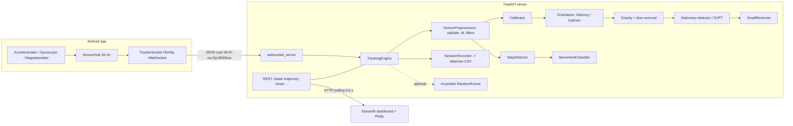

# Architecture

| path | role |
|---|---|
| `android_app/` | Kotlin app (UI, sensors, WebSocket, auto-reconnect) |
| `server/main.py` | FastAPI app + REST; `websocket_server.py` WebSocket endpoint |
| `server/tracking_engine.py` | pipeline orchestration, session state, snapshots |
| `server/{sensor_processor,orientation,dead_reckoning,step_detector,movement_classifier}.py` | algorithms |
| `server/recorder.py`, `server/evaluation.py` | recording, accuracy metrics against ground truth |
| `ml/` | feature extraction (shared with the live server), training, prediction |
| `dashboard/app.py` | Streamlit UI |
| `tools/` | simulator + synthetic generator (**dev/test only**, packets are flagged `source=simulator`) |
| `tests/` | 51 pytest tests |

Design choices: one in-process engine guarded by a lock (50 Hz of tiny numpy ops is far below one core); the dashboard is a pure
REST client so it can run on another machine; the ML model is optional and never fabricated.
